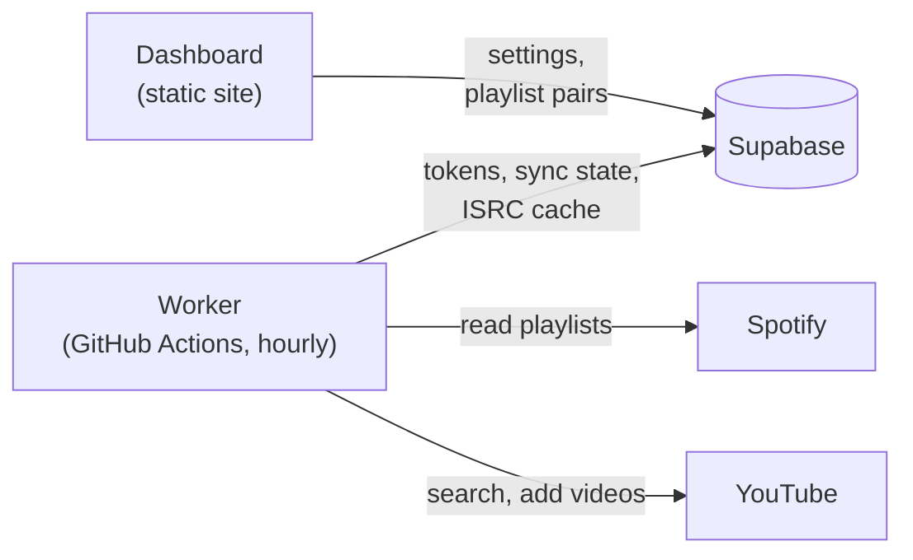

# cronchords

Keeps YouTube Music playlists in sync with your Spotify playlists. Every hour a
GitHub Actions job checks your Spotify playlists and adds new songs to their
YouTube counterparts.

Everything runs on free tiers and on your own API keys: GitHub Actions for the
sync, a Supabase database for its state, and a static dashboard that you can
host on GitHub Pages or Vercel. There is no server to run or pay for.

## How it works



- `web/` is the dashboard, a small React app. You use it to connect your
  Spotify and YouTube accounts and to pick which playlists to sync.
- `supabase/` holds the database schema: one row of settings and tokens, the
  playlist pairs, and a cache that maps songs (by ISRC) to YouTube videos.
- `worker/` is the Python script the hourly workflow runs.

On each run the worker:

1. Gets fresh Spotify and YouTube access tokens.
2. Compares each Spotify playlist's `snapshot_id` with the one from the last
   sync. If it hasn't changed, the playlist is skipped and no YouTube quota is
   spent.
3. If it has changed, reads the tracks and looks up their ISRC codes in the
   cache. Only songs that were never searched for go to YouTube search.
4. Picks the best search result. Uploads from "Artist - Topic" channels are
   preferred, since those are the actual album tracks and show up as songs in
   YouTube Music. Title, artist and length have to match, and covers, live
   versions, remixes and the like are skipped unless the Spotify track is one
   too.
5. Adds the songs that are missing from the YouTube playlist, saving every
   match to the cache right away. Once the whole playlist is done, the new
   `snapshot_id` is stored.

The sync is one-way and only adds songs: removing a song on Spotify does not
remove it from YouTube.

## Limits

- **YouTube quota.** A Google Cloud project gets 100 searches and 10,000 other
  units a day. Adding a song to a playlist costs 50 units, so about 100 new
  songs can be synced per day. A big playlist takes a few days the first
  time; the worker continues where it stopped once the quota resets at
  midnight Pacific time. Songs already in the cache don't need a search, so the
  same song in a second playlist only costs the 50 units. You can ask Google
  for more quota if you need it.
- **Spotify.** Apps in Development Mode need an owner with Spotify Premium, and
  can only read playlists you own or collaborate on. Spotify refresh tokens
  expire six months after connecting, so you have to reconnect Spotify twice a
  year. The dashboard shows when, and the worker warns two weeks ahead.
- Local files, podcast episodes and tracks without an ISRC are skipped.
- GitHub disables scheduled workflows in public repositories after 60 days
  without repository activity. If that happens, re-enable the Sync workflow
  from the Actions tab.
- Free Supabase projects are paused after a week without database activity.
  The hourly sync reads and writes the database, so this only happens if the
  sync is off.

## Setup

You will need a GitHub account, a Supabase account, a Spotify Premium account
and a Google account with a YouTube channel. The setup takes about 20 minutes.

### 1. Fork the repository

Fork this repository. Keep in mind that the logs of GitHub Actions in public
repositories are public. The worker never prints tokens, but playlist and song
names do show up in the logs. If you'd rather keep them private, push a copy of
this repository to a private one instead of forking (and host the dashboard on
Vercel, since GitHub Pages needs a public repository on the free plan).

### 2. Create the Supabase project

1. Create a free project on [supabase.com](https://supabase.com).
2. Open the SQL Editor, paste in
   [`supabase/migrations/20261020120000_initial_schema.sql`](supabase/migrations/20261020120000_initial_schema.sql)
   and run it. If you use the Supabase CLI, `supabase link` and
   `supabase db push` do the same.
3. Under Authentication > Users, add a user with your email and a password
   ("Create new user", with "Auto Confirm User" checked). This is the login for
   the dashboard. Only the first user of the project can see or change
   anything, but you can also turn off "Allow new users to sign up" under
   Authentication > Sign In / Providers to be sure.
4. Under Project Settings > API Keys, find the publishable key
   (`sb_publishable_...`) and the secret key (`sb_secret_...`). The project URL
   is `https://<project-ref>.supabase.co`.

### 3. Deploy the dashboard

The dashboard's address is the redirect URI you'll register at Spotify and
Google, so deploy it first. Either option is free.

**GitHub Pages**

1. In your fork, go to Settings > Pages and set the source to "GitHub Actions".
2. Under Settings > Secrets and variables > Actions > Variables, add
   `SUPABASE_URL` and `SUPABASE_PUBLISHABLE_KEY`.
3. Run the "Deploy dashboard" workflow from the Actions tab. The dashboard will
   be at `https://<your-user>.github.io/<repository>/`, and it is redeployed
   whenever `web/` changes.

**Vercel**

1. Import your fork on [vercel.com](https://vercel.com/new) and set the root
   directory to `web`. Vite is detected automatically.
2. Add the environment variables `VITE_SUPABASE_URL` and
   `VITE_SUPABASE_PUBLISHABLE_KEY`.
3. Deploy. Netlify and Cloudflare Pages work the same way: build `web` with
   `npm run build` and serve `web/dist`.

The Supabase URL and publishable key end up in the public JavaScript bundle.
That's what they are for: without signing in, they give access to nothing.

### 4. Create a Spotify app

1. Go to the [Spotify developer dashboard](https://developer.spotify.com/dashboard)
   and create an app.
2. Add your dashboard's address as a redirect URI, exactly as the dashboard
   shows it (for example `https://you.github.io/cronchords/`). For local
   development, also add `http://127.0.0.1:5173/`.
3. Select "Web API", save, and copy the client ID. There's no client secret to
   copy: the dashboard uses the PKCE flow.
4. If the playlists belong to a different Spotify account than the app's
   owner, add that account under User Management.

### 5. Create a Google OAuth client

YouTube only lets you change playlists with an OAuth token; an API key is not
enough.

1. In the [Google Cloud console](https://console.cloud.google.com/), create a
   project and enable the "YouTube Data API v3" for it.
2. Open Google Auth Platform and fill in the app name and contact details. For
   the audience, choose "External".
3. Under Audience, click "Publish app" so the status becomes "In production".
   This matters: while an app is in "Testing", Google's refresh tokens expire
   after 7 days and the sync would stop every week. An app used only by you
   doesn't need Google's verification; you'll just click through an
   "unverified app" warning when connecting.
4. Under Clients, create an OAuth client of type "Web application" and add the
   dashboard's address to the authorized redirect URIs (plus
   `http://127.0.0.1:5173/` for local development). Copy the client ID and
   the client secret.

### 6. Connect your accounts

1. Open the dashboard and sign in with the Supabase user from step 2.
2. Paste the Spotify client ID and click "Connect Spotify".
3. Paste the Google client ID and secret and click "Connect YouTube". Choose the
   account (or brand channel) whose playlists you want to fill.
4. Under "New sync", pick a Spotify playlist and a YouTube playlist, or let the
   dashboard create a private YouTube playlist with the same name.

### 7. Turn on the hourly sync

1. Under Settings > Secrets and variables > Actions, add the repository secret
   `SUPABASE_SECRET_KEY` with the secret key from step 2, and the variable
   `SUPABASE_URL` if you didn't add it in step 3.
2. GitHub turns off workflows in forks. Open the Actions tab and enable them.
3. Run the "Sync" workflow once by hand to see that everything works. From then
   on it runs every hour.

The worker uses the secret key rather than the publishable one because it
reads the stored tokens, which the database only shows to the dashboard's owner
and to the secret key.

## Troubleshooting

- **"Spotify rejected the stored refresh token"**: reconnect Spotify in the
  dashboard. This is expected every six months.
- **"Google rejected the stored credentials"**: reconnect YouTube. If it happens
  every week, the OAuth app is still in "Testing" (step 5.3).
- **"Waiting for the YouTube API quota to reset"** or **"song(s) still to
  sync"**: the daily quota ran out. Nothing to do, the next runs continue.
- **A song was matched to the wrong video**: in the Supabase table editor, find
  the song's row in `track_sync_cache` and put the right video ID in
  `youtube_video_id` (or clear it to skip the song), then remove the wrong video
  from the YouTube playlist. The right one is added the next time that Spotify
  playlist changes.

## Development

The worker needs Python 3.11 or newer, the dashboard Node.js 20.19+ or 22.12+.
A local Supabase stack needs Docker.

```sh
# Local database (applies the migrations and prints the local keys)
npx supabase start

# Dashboard: put your Supabase URL and publishable key in .env.local
cd web
cp .env.example .env.local
npm install
npm run dev

# Worker
cd worker
python -m venv .venv
. .venv/bin/activate
pip install -r requirements-dev.txt
pytest
SUPABASE_URL=... SUPABASE_SECRET_KEY=... python -m cronchords
```

The dev server runs on `http://127.0.0.1:5173/`. Open it there rather than on
`localhost`, because Spotify doesn't accept `localhost` redirect URIs.

## License

[MIT](LICENSE)
