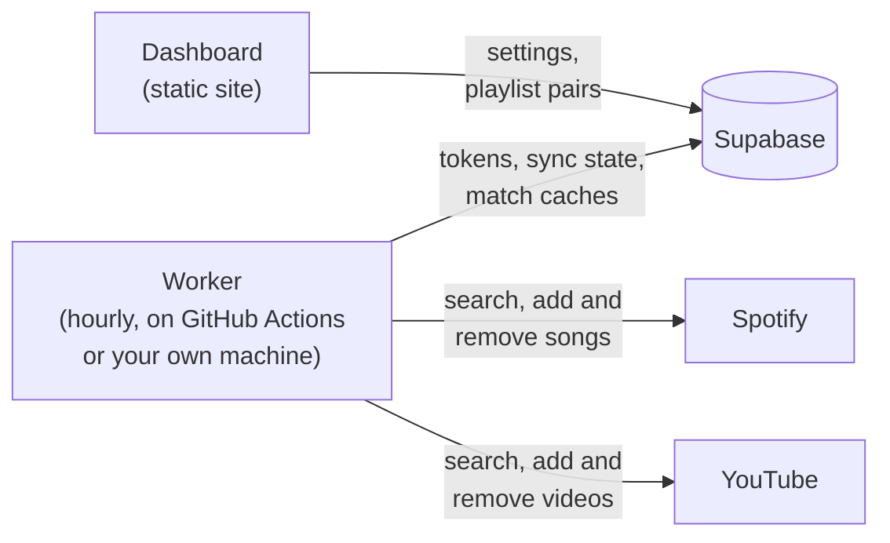

# cronchords

Keeps Spotify and YouTube Music playlists in sync: from Spotify to YouTube,
from YouTube to Spotify, or both ways. Every hour a worker checks the playlists
you paired up and carries the changes over to the other side.

Everything runs on free tiers and on your own API keys: GitHub Actions for the
sync, a Supabase database for its state, and a static dashboard that you can
host on GitHub Pages or Vercel. There is no server to run or pay for. If you
have one anyway, or a Raspberry Pi, the worker can run there instead of on
GitHub Actions.

## How it works



- `web/` is the dashboard, a small React app. You use it to connect your
  Spotify and YouTube accounts and to pick which playlists to sync.
- `supabase/` holds the database schema: one row of settings and tokens, the
  playlist pairs, and two caches, one that maps Spotify songs (by ISRC) to
  YouTube videos and one for the other way round.
- `worker/` is the Python script that does the syncing. The hourly workflow
  runs it, or you run it on a machine of your own.

On each run the worker:

1. Gets fresh Spotify and YouTube access tokens.
2. Checks every pair for changes since the last sync. Spotify playlists have a
   `snapshot_id` that changes with every edit. YouTube playlists have nothing
   like it, so for pairs that sync from YouTube the worker lists the videos and
   compares them with the last run. Pairs without changes are skipped.
3. Finds the counterpart of every song that is new on one side:
   - For a Spotify track, it looks up the ISRC in the cache, and only searches
     YouTube for songs it hasn't seen before. Uploads from "Artist - Topic"
     channels are preferred, since those are the actual album tracks and show
     up as songs in YouTube Music.
   - For a YouTube video, it first checks whether the song is on the Spotify
     playlist already (maybe as another release), and otherwise searches
     Spotify with the video's title, cleaned of "(Official Video)" and the
     like.

   Title, artist and length have to match, and covers, live versions, remixes
   and the like only match each other.
4. Adds the songs that are missing on the other side, saving every match to
   the cache right away. Once a pair is done, the new snapshot is stored.
5. For pairs that sync both ways, it also removes songs, see below.

### Sync directions

Every pair of playlists has a direction, which you pick when you create it:

- **Spotify → YouTube** and **YouTube → Spotify** copy new songs over and never
  remove anything. If you remove a song on the receiving side, it's added back
  in a later run.
- **Both ways** copies new songs from either side to the other, and when you
  remove a song on one side, it's removed on the other side too. To tell the
  two apart, the worker remembers which songs were on both sides after the
  last run. If a playlist suddenly comes back empty, nothing is removed and the
  dashboard shows a warning instead, in case that was a glitch. A playlist that
  syncs both ways can't be part of another pair, since the pairs would pass
  each other's removals on.

In a pair that syncs both ways, you can fix a wrong match in the playlist
itself: remove the song the worker added and add the right one. For 72 hours
after the worker adds a song, removing it doesn't remove the song on the other
side straight away. The worker waits 12 hours for a song with the same title
to be added in its place, then pairs that one with the song on the other side
and changes nothing else. It also uses the new match for other playlists from
then on. If no such song is added in 12 hours, the song is removed on the other
side too.

Songs that have no match on the other side stay where they are. When a video
on YouTube gets deleted or made private, the worker looks for another upload of
the song, and you can remove the dead entry from the playlist without the song
disappearing from Spotify.

## Limits

- **YouTube quota.** A Google Cloud project gets 100 searches and 10,000 other
  units a day. Adding a song to a YouTube playlist costs 50 units, so about 100
  new songs can go to YouTube per day. A big playlist takes a few days the
  first time; the worker continues where it stopped once the quota resets at
  midnight Pacific time. Songs already in the cache don't need a search, so the
  same song in a second playlist only costs the 50 units. Removing a song from
  YouTube costs 50 units as well. Pairs that sync from YouTube also list their
  YouTube playlist on every run, which costs 1 unit per 50 videos, so about 24
  units a day for a playlist of up to 50 songs. You can ask Google for more
  quota if you need it.
- **Spotify.** Apps in Development Mode need an owner with Spotify Premium, and
  can only read and change playlists you own or collaborate on. Searching
  Spotify has no daily limit, so songs from YouTube aren't held back by a
  quota. Spotify refresh tokens expire six months after connecting, so you have
  to reconnect Spotify twice a year. The dashboard shows when, and the worker
  warns two weeks ahead.
- **Matching.** Spotify tracks carry an ISRC, YouTube videos don't, so songs
  coming from YouTube are matched by title, artist and length alone. Topic
  uploads and official videos match well; lyric videos, fan uploads and
  unusual titles may find no match and are left out.
- Local files and podcast episodes are skipped, and so are deleted and private
  YouTube videos.
- GitHub disables scheduled workflows in public repositories after 60 days
  without repository activity. If that happens, re-enable the Sync workflow
  from the Actions tab.
- Free Supabase projects are paused after a week without database activity.
  The hourly sync reads and writes the database, so this only happens if the
  sync is off.

## Setup

You will need a GitHub account, a Supabase account, a Spotify Premium account
and a Google account with a YouTube channel. The setup takes about 20 minutes.

### 1. Fork the repository

Fork this repository. Keep in mind that the logs of GitHub Actions in public
repositories are public. The worker never prints tokens, but playlist and song
names do show up in the logs. If you'd rather keep them private, push a copy of
this repository to a private one instead of forking (and host the dashboard on
Vercel, since GitHub Pages needs a public repository on the free plan).

### 2. Create the Supabase project

1. Create a free project on [supabase.com](https://supabase.com).
2. Open the SQL Editor and run the files in
   [`supabase/migrations`](supabase/migrations) one after the other, oldest
   first: paste one in, run it, then the next. If you use the Supabase CLI,
   `supabase link` and `supabase db push` do the same.
3. Under Authentication > Users, add a user with your email and a password
   ("Create new user", with "Auto Confirm User" checked). This is the login for
   the dashboard. Only the first user of the project can see or change
   anything, but you can also turn off "Allow new users to sign up" under
   Authentication > Sign In / Providers to be sure.
4. Under Project Settings > API Keys, find the publishable key
   (`sb_publishable_...`) and the secret key (`sb_secret_...`). The project URL
   is `https://<project-ref>.supabase.co`.

### 3. Deploy the dashboard

The dashboard's address is the redirect URI you'll register at Spotify and
Google, so deploy it first. Either option is free.

**GitHub Pages**

1. In your fork, go to Settings > Pages and set the source to "GitHub Actions".
2. Under Settings > Secrets and variables > Actions > Variables, add
   `SUPABASE_URL` and `SUPABASE_PUBLISHABLE_KEY`.
3. Run the "Deploy dashboard" workflow from the Actions tab. The dashboard will
   be at `https://<your-user>.github.io/<repository>/`, and it is redeployed
   whenever `web/` changes.

**Vercel**

1. Import your fork on [vercel.com](https://vercel.com/new) and set the root
   directory to `web`. Vite is detected automatically.
2. Add the environment variables `VITE_SUPABASE_URL` and
   `VITE_SUPABASE_PUBLISHABLE_KEY`.
3. Deploy. Netlify and Cloudflare Pages work the same way: build `web` with
   `npm run build` and serve `web/dist`.

The Supabase URL and publishable key end up in the public JavaScript bundle.
That's what they are for: without signing in, they give access to nothing.

### 4. Create a Spotify app

1. Go to the [Spotify developer dashboard](https://developer.spotify.com/dashboard)
   and create an app.
2. Add your dashboard's address as a redirect URI, exactly as the dashboard
   shows it (for example `https://you.github.io/cronchords/`). For local
   development, also add `http://127.0.0.1:5173/`.
3. Select "Web API", save, and copy the client ID. There's no client secret to
   copy: the dashboard uses the PKCE flow.
4. If the playlists belong to a different Spotify account than the app's
   owner, add that account under User Management.

### 5. Create a Google OAuth client

YouTube only lets you change playlists with an OAuth token; an API key is not
enough.

1. In the [Google Cloud console](https://console.cloud.google.com/), create a
   project and enable the "YouTube Data API v3" for it.
2. Open Google Auth Platform and fill in the app name and contact details. For
   the audience, choose "External".
3. Under Audience, click "Publish app" so the status becomes "In production".
   This matters: while an app is in "Testing", Google's refresh tokens expire
   after 7 days and the sync would stop every week. An app used only by you
   doesn't need Google's verification; you'll just click through an
   "unverified app" warning when connecting.
4. Under Clients, create an OAuth client of type "Web application" and add the
   dashboard's address to the authorized redirect URIs (plus
   `http://127.0.0.1:5173/` for local development). Copy the client ID and
   the client secret.

### 6. Connect your accounts

1. Open the dashboard and sign in with the Supabase user from step 2.
2. Paste the Spotify client ID and click "Connect Spotify".
3. Paste the Google client ID and secret and click "Connect YouTube". Choose the
   account (or brand channel) whose playlists you want to fill.
4. Under "New sync", pick a Spotify playlist, a direction and a YouTube
   playlist. The dashboard can also create a private playlist with the same
   name on the receiving side.

### 7. Turn on the hourly sync

This runs the worker on GitHub Actions. To run it on a machine of your own
instead, skip this step and see
[Running the worker on your own machine](#running-the-worker-on-your-own-machine).

1. Under Settings > Secrets and variables > Actions, add the repository secret
   `SUPABASE_SECRET_KEY` with the secret key from step 2, and the variable
   `SUPABASE_URL` if you didn't add it in step 3.
2. GitHub turns off workflows in forks. Open the Actions tab and enable them.
3. Run the "Sync" workflow once by hand to see that everything works. From then
   on it runs every hour.

The worker uses the secret key rather than the publishable one because it
reads the stored tokens, which the database only shows to the dashboard's owner
and to the secret key.

## Running the worker on your own machine

The worker doesn't have to run on GitHub Actions. Any computer that's always on
will do: a Raspberry Pi, a home server or a VPS. It only makes outgoing
requests, so it needs no open ports and no public address.

Run it in one place only, since two workers syncing at the same time could add
the same songs twice. If the Sync workflow is turned on in your fork, turn it
off under Actions > Sync > ⋯ > Disable workflow. The dashboard stays where it
is.

The worker needs the project URL and the secret key from step 2. They go in a
`.env` file in the `worker` folder:

```sh
git clone https://github.com/<you>/cronchords.git
cd cronchords/worker
cp .env.example .env
chmod 600 .env
```

Fill in the two values in `.env`. The secret key gives full access to the
database, so keep the file to yourself.

### With Docker

With [Docker](https://docs.docker.com/engine/install/) installed, in the
`worker` folder:

```sh
docker compose up -d --build
```

This builds the image and starts the worker in the background. It syncs right
away and then every hour, and it starts again after a reboot.

- `docker compose logs -f` shows what it's doing.
- `docker compose restart` syncs right away.
- To update, run `git pull`, then `docker compose up -d --build` again.

### Without Docker

You need Python 3.11 or newer. Raspberry Pi OS and Debian have it since
Bookworm, Ubuntu since 24.04. On these, you may have to
`sudo apt install python3-venv` first. Then, in the `worker` folder:

```sh
python3 -m venv .venv
.venv/bin/pip install -r requirements.txt
```

To keep the worker running, make it a systemd service. Save this as
`/etc/systemd/system/cronchords.service`, with your user name in place of `pi`
and the path of your clone in place of `/home/pi/cronchords`:

```ini
[Unit]
Description=cronchords playlist sync
Wants=network-online.target
After=network-online.target

[Service]
User=pi
WorkingDirectory=/home/pi/cronchords/worker
EnvironmentFile=/home/pi/cronchords/worker/.env
ExecStart=/home/pi/cronchords/worker/.venv/bin/python -m cronchords --every 60
Restart=on-failure

[Install]
WantedBy=multi-user.target
```

Then start it, and watch the first sync:

```sh
sudo systemctl enable --now cronchords
journalctl -u cronchords -f
```

To update, run `git pull`, then `sudo systemctl restart cronchords`.

### How often it syncs

`--every 60` syncs every 60 minutes, starting right away. To change it, edit
the number in `compose.yaml` or in the service file. Syncing more often costs
more YouTube quota, since pairs that sync from YouTube list their YouTube
playlist on every run (see [Limits](#limits)). Without `--every`, the worker
syncs once and exits, so you can also run it from cron.

## Troubleshooting

- **"Spotify rejected the stored refresh token"**: reconnect Spotify in the
  dashboard. This is expected every six months.
- **"Google rejected the stored credentials"**: reconnect YouTube. If it happens
  every week, the OAuth app is still in "Testing" (step 5.3).
- **"Waiting for the YouTube API quota to reset"** or **"song(s) still to
  sync"**: the daily quota ran out. Nothing to do, the next runs continue.
- **"Spotify didn't allow changing the playlist"**: reconnect Spotify in the
  dashboard. Connections made before cronchords could sync to Spotify only
  allowed reading playlists.
- **A song was matched to the wrong video**: in a pair that syncs both ways,
  within 72 hours of the worker adding the video, replace it with the right one
  in the YouTube playlist (see [Sync directions](#sync-directions)). Otherwise,
  in the Supabase table editor, find the song's row in `track_sync_cache` and
  put the right video ID in `youtube_video_id` (or clear it to skip the song),
  then remove the wrong video from the YouTube playlist. The right one is added
  the next time that Spotify playlist changes. For a pair that syncs both ways,
  add the right video to the YouTube playlist first and remove the wrong one
  after: removing it alone would remove the song from Spotify too.
- **A video was matched to the wrong Spotify track**: the same the other way
  round. Within 72 hours in a pair that syncs both ways, replace the track in
  the Spotify playlist. Otherwise put the right track ID (the part after
  `/track/` in the song's Spotify link) in `spotify_track_id` in
  `video_sync_cache`, or clear it to skip the video. Then remove the wrong track
  from the Spotify playlist, or, for a pair that syncs both ways, add the right
  track first and then remove the wrong one.

## Development

The worker needs Python 3.11 or newer, the dashboard Node.js 20.19+ or 22.12+.
A local Supabase stack needs Docker.

```sh
# Local database (applies the migrations and prints the local keys)
npx supabase start

# Dashboard: put your Supabase URL and publishable key in .env.local
cd web
cp .env.example .env.local
npm install
npm run dev

# Worker
cd worker
python -m venv .venv
. .venv/bin/activate
pip install -r requirements-dev.txt
pytest
SUPABASE_URL=... SUPABASE_SECRET_KEY=... python -m cronchords
```

The dev server runs on `http://127.0.0.1:5173/`. Open it there rather than on
`localhost`, because Spotify doesn't accept `localhost` redirect URIs.

## License

[MIT](LICENSE)
